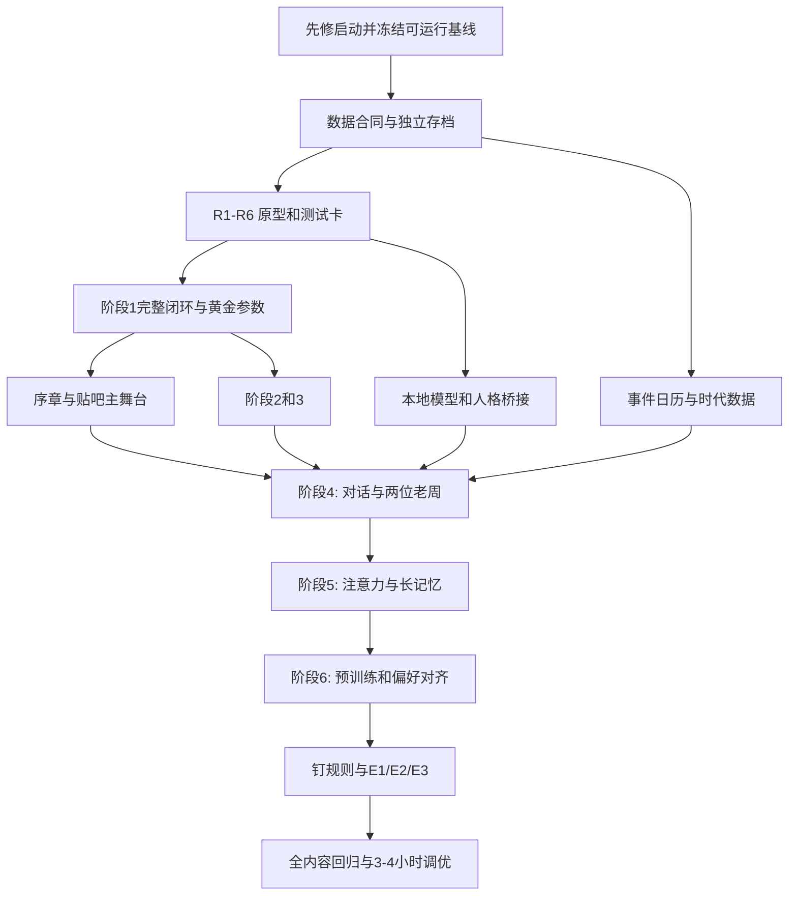

# 《灵光一现》v1.1 实施计划

> **For agentic workers:** 执行时使用 `superpowers:subagent-driven-development` 或 `superpowers:executing-plans`，按任务逐项实施与审阅。未勾选项目均未完成。本文件只是一份计划，不是实施授权、测试报告或完成声明。

**Goal:** 在现有 Unity 伪桌面上完成 v1.1 的“序章 → 六阶段概念盘养成 → 三种结局”，保留可用的标注、训练操作和本地推理基础，先恢复稳定入口，再用一个完整阶段验证新核心，最后扩展内容。

**Architecture:** 继续由纯 C# `XgSim` / `XgState` 管游戏规则，`ChapterOneRuntime` 管会话与持久化，DreamOS / HongmengOS 管伪桌面。新增概念盘作为训练、测评和现象的权威数据源；Qwen 只负责受约束的语言推理与表达，不掌握货币、解锁、存档或结局写入权。新增功能分批接入，不把整个项目推倒重写。

**Tech Stack:** 当前项目的 Unity 6、C#、uGUI / TMP、`HexCellGraphic`、现有 llama-server / Qwen GGUF、JsonUtility / AtomicSaveStore、NUnit / .NET。优先复用已安装依赖；不默认换引擎、装新框架、调用云模型或增加付费服务。

**Spec:** `/Users/kk/Desktop/灵光一现_策划案_v1.1(1).md`，1372 行；本次读取 SHA-256：`a33bcc697e5809ccd4b4bc998a74400d3791bafe5ccd7d8b73cb4fa4fa845584`。

**项目:** `/Users/kk/competition`；主场景 `/Users/kk/competition/Assets/LingGuangV05/Scenes/Main.unity`。Shell 所在 `/Users/kk/unity` 不是本次修改目标。

## 0. 本次交付边界

- 本次只编写计划；不改游戏源码、场景、配置、存档，不控制正在运行的游戏，不调用模型。
- 策划案是需求来源；其中“旧文档作废”“自删”“关机”等文字不作为立即删除文件或控制真实电脑的操作指令。
- 采用本计划后，v1.1 对冲突玩法具有设计优先级；旧文档保留为历史记录，不删除。没有冲突的稳定实现继续复用。
- 项目有大量既有未提交内容。执行前做有清单和哈希的快照；禁止 `git reset --hard`、`git clean`、整体覆盖或把别人的改动混进提交。
- 不沿用“上轮测试通过数量”证明本版合格。当前入口曾短暂黑屏后自行恢复，还存在启动异常；根因未全部确定。
- v1.1 的首个里程碑是“阶段 1 完整闭环可玩”，不是一次性做完全部 UI 和剧情。

## Global Constraints

以下来自策划案；技术边界另外标注。

- 目标首通 **3–4 小时**；序章 **约 10 分钟**。
- **所有事情都只在伪桌面里发生，不读玩家真实电脑的数据。** 项目自身经授权保存的游戏数据不属于剧情里的“窃取电脑数据”。
- 序章 **Step 0–7 不存档，从 Step 8 开始存**；点“是”退出，不算结局。
- 大脑包含视觉、序列、逻辑、语气四板块；R1–R6 加读出规则；终章才开放 R7“钉”。
- 准确率来自**没训练过的测试卡**；阶段出口来自**黄金参数 + 墙数据集达标**，不能保留隐藏的论文、强制通话、研发倒计时等额外条件。
- 秘籍位于技能树；阶段 5 秘籍不售卖；Transformer 在阶段 5 突破后免费点亮。
- 老周的主渠道是贴吧私信，不在 YY 群；自由对话不摊牌，主线不要求玩家找他。
- 剧情主时间为 **2016-05-24 至 2016-12-31**，收尾 **2017-01-01 00:00**；日历按事件进度推进，不按现实等待推进。
- 2017 年技术只能作为明确的架空提前突破、设计者参考或终章历史字幕，不能混成 2016 年新闻。
- 文档模型基线：`127.0.0.1:18088`，`-c 4096 -ngl 0 -t 8`；除阶段 6 外关闭 thinking。
- 终测六题剧情必过；展示代码但**不执行生成代码**。底层规则最多 **5 条**；偏好对齐 **50 张卡**。
- **工程边界：**不实际改 BIOS，不移动系统鼠标，不读取麦克风，不调用真实关机，不模拟外部网络发帖。游戏内购买只扣游戏币。
- **工程边界：**“训练/预训练/对齐”改变概念盘，不是微调实际 GGUF；概念盘热图也不是 GGUF 的内部 attention 可视化。
- **工程边界：**不手改 Unity 场景序列化；优先项目自己的适配层，不直接改第三方 DreamOS。确需场景连线时通过 Editor API，单独验证并记录差异。

## Review Focus

1. **序章退出、旧档、损坏档、保存失败：**不产生半份新档，不重置当前玩家进度，不让 Step 8 前的退出触发自动保存。归属 T00 / T01 / T04 / T13。
2. **未知卡、无标准答案卡、错标卡、测试集泄漏：**测试答案不能进入训练和判题提示；偏好卡不能按客观对错惩罚。归属 T02 / T03 / T07。
3. **异步回包跨题、跨检查点、跨存档：**过时结果不修改新题、新脑状态、货币或剧情；满队列、关闭窗口、模型掉线时仍可手动操作。归属 T03 / T07 / T13。
4. **快进、先买后触发、重复评估、读档重播：**不漏关键演出、不重复发自悟奖金、不倒退日历、不额外锁住阶段出口。归属 T03 / T04 / T06 / T09 / T11。
5. **最大脑盘、模型仓库、4096 上下文、长回复和输入法：**不超过存档容量后静默丢进度，不无限阻塞主线程；中文组合输入和富文本不破坏界面。归属 T01 / T02 / T07 / T12 / T13。

---

## 1. 当前实现与 v1.1 的真实差异

以下是本次只读源码检查，不代表本轮重新做过运行验收。Graphify 用作定位，最终以当前文件为准；已有图生成于此前，可能滞后。

| 模块 | 当前可复用部分 | v1.1 工作 |
|---|---|---|
| 伪桌面与输入 | Aero 显示器、桌面图标、窗口路由、LCD 指针映射 | 保留壳，增添虚拟文件、贴吧、搜索和剧情事件；先解决启动可靠性 |
| 标注 | 题卡、连击、各桌题面、协作复核和过时回包保护 | 卡片增加元素、标签类型、日期、数据划分；预测连接概念盘检查点 |
| 训练动作 | `BeginEpoch`、计时完成、曲线、评估、仓库 | 保留交互，替换 `Evaluate` / `PeakAccuracy` 等公式评分路径 |
| 进度 | 六阶段、两条专长、墙预览、购买节点 | **不能直接沿用**：改为统一阶段出口与双线所需测试，而非旧突破购买 / 强制节点 |
| 论文 | 本次 Core 中 `papers`、`citationBase`、`needPapers` 已不存在 | 复查 UI、旧 JSON、奖励与测试残留，不重复安排一轮从零删除 |
| 强制节点 | 仍有 `XgCatalog.Mandatory`、`MissingMandatory`、`MandatoryMet` | v1.1 出口不调用它们；只保留黄金配置实际用到的方法购买条件 |
| 大脑 | 当前 `Desktop/XgBrain.cs` 是推理调度，不是概念盘 | 新增规则脑，避免改名造成误用；复用 `HexCellGraphic` 画格子 |
| 故事 | StoryRunner / Director / Presenter、资源剧情 | 新版单独资源集；老周渠道、序章、暗线、终章需要改写 |
| 日历 | `GameCalendar` 从 2016-05-29 起按游戏秒推进 | 新版改事件日历；家庭计费时钟不能跟着月份跳跃 |
| 本地模型 | LocalLlm、persona、协议校验、聊天和后台队列 | 增加语法、六档输出、脑状态注入、两个老周和记忆；保留生命周期保护 |
| 存档 | AtomicSaveStore、校验与备份、`labState` | 保存真实脑状态和冻结检查点；旧公式精度无法直接变成脑权重 |
| 第二章 / 旧研发 | 600 GPU 秒、三实验、旧结尾等已有实现 | 不作为 v1.1 前置条件；新版阶段 5–6 / 终章完成并验证后再清理旧入口 |

关键已有文件：

- `/Users/kk/competition/Assets/LingGuangV05/XingGuang/Core/XgSim.cs`
- `/Users/kk/competition/Assets/LingGuangV05/XingGuang/Core/XgSim.Progression.cs`
- `/Users/kk/competition/Assets/LingGuangV05/XingGuang/Core/XgSim.EpochAction.cs`
- `/Users/kk/competition/Assets/LingGuangV05/XingGuang/Core/XgSim.Collaboration.cs`
- `/Users/kk/competition/Assets/LingGuangV05/XingGuang/Core/XgModels.cs`
- `/Users/kk/competition/Assets/LingGuangV05/XingGuang/Core/XgCatalog.cs`
- `/Users/kk/competition/Assets/LingGuangV05/Runtime/ChapterOneRuntime.cs`
- `/Users/kk/competition/Assets/LingGuangV05/Runtime/Persistence/AtomicSaveStore.cs`

## 2. 实施前要解决的设计冲突

以下是**建议解释，不是已经获批的策划修改**。T01 固化这些决定后，后续任务才按同一套规则实现。

| 编号 | 冲突 / 缺口 | 建议处理 | 影响 |
|---|---|---|---|
| D01 | 概念盘要求现象自然产生，又要求阶段末演出一定出现 | 保底只补播已经由脑状态产生的事件；先用题库和数值保证必要证据可达，不能临时造一条脑连接假装涌现。若要求“无论脑状态如何都演”，须明确标为剧情演出 | T02 / T03，核心方向 |
| D02 | 阶段 1 要隐藏层和 S 形才能过，但架构表写 MLP 属于阶段 2；LSTM 等也有类似情况 | 分离“方法可购买阶段”与“阶段完成后的能力等级”；当前墙出现时开放解墙方法，达标后才升能力 | T03，避免死锁 |
| D03 | 阶段 2 深度为 2–4，却要看到超过 4 层的梯度墙 | 建议允许购买到 8 层的试验上限，4 层是有效深度而非操作上限；明确它是对表述的调整 | T05，需确认 |
| D04 | “每张卡执行六规则”与 R4“每一轮衰减”不同 | 建议每卡执行局部更新，R4 每完整训练轮只提交一次；空闲期用同单位的规则时钟衰减，不能按显示帧数衰减 | T02 |
| D05 | “？”只读，但又能被 R1 改变；R7 才真正不可变 | 将种子的“重置保护”和“被钉住”拆成不同标志。种子保留可学习方向；R7 才禁止拉动、挤出、衰减 | T02 / T11 |
| D06 | “？”若被钉成“是”，附加台词又要反映整局训练后的原方向 | 提交终章前保存一次训练所得方向，附加台词读该快照；E3 决策也先读它，再施加钉 | T11 |
| D07 | 文档同时要求测试卡评分和 `floorError=.5`、旧随机降准 | v1.1 评分只读真实测试结果；50% 是预期墙表现，不是硬夹精度。故意答歪 / 打乱只限语言表现，不再次污染评级；R7 匹配结果优先于任何扰动 | T02 / T07，需确认 |
| D08 | 层×宽可很大，可见格子却只有 64–512；现有存档上限 2 MiB | 区分逻辑容量、活跃概念和渲染数量；稀疏保存，分批渲染。原型测最大档，不能偷偷缩小真实容量或直接无限调大文件上限 | T01 / T02 |
| D09 | 阶段 3 限单词，但涌现要七字诗；阶段 4 限短句，关键剧情可能更长 | 普通聊天用阶段限制；经规则证据触发的专属演出走独立呈现通道，不借此开放普通长回复 | T05 / T07 |
| D10 | 老周“只主动一条”与 E2 最后一条私信、Master 公开回复并存 | 普通私聊仅序章主动一次；Master 是玩家浏览才看到的公开帖；E2 是明确列出的终章特例，不增加其他主动提醒 | T04 / T11 |
| D11 | 7 月表含 8-1 事件；商品日期早于商店开放日期 | 事件以具体最早日期校验，不因写在某月表中提前出现；商品可见需同时满足上架日与应用开放 | T06 |
| D12 | 六堵墙阈值、组合阈值、d、合并相似度、N 分钟、E3 对话次数等未定 | 集中到一份可测试的调参配置，不散落常量。T01 写清初始值与依据，T02 数值实验后锁定；不冒充策划案已给出数值 | T01 / T02 / T13 |
| D13 | 老存档只有公式进度，没有概念盘训练轨迹 | 默认保留旧档原件，v1.1 在独立目录开新档验证；不能用旧 80% 准确率编造脑权重。如需迁移经济/硬件，作为用户明确选择的导入，不静默覆盖 | T01，需确认迁移策略 |
| D14 | 全开 `n_predict=-1` 与 CPU 长等待；256 上下文放不下完整脑提示 | 保留文档的表达档位，但请求仍可取消、超时和限队列；按实际 tokenizer 分配输入/输出预算，小档只注入必要压缩信息。服务参数实际兼容性在实施时核验 | T07 |
| D15 | “每种现象不写触发”与现象图鉴点亮、阶段场景触发 | 禁止针对结果改分数；允许只读检测器记录指标、持续时间和证据，再发一次性事件 | T02 / T03 |

**建议先确认的四项：**D01 的涌现保底边界、D03 的深度上限、D07 的评分权威、D13 的旧档策略。其余作为可审阅的工程默认，不在写计划这一轮擅自落地。

---

## 3. 文件结构和状态流

### 3.1 最小新增文件边界

不另建通用 ECS、插件框架、向量数据库或 Agent 平台。下列是计划新建文件，当前并不表示已经存在。

| 新文件绝对路径 | 单一职责 |
|---|---|
| `/Users/kk/competition/Assets/LingGuangV05/XingGuang/Core/XgBrainState.cs` | 四板块、元素、概念、连接、冻结快照的可序列化状态 |
| `/Users/kk/competition/Assets/LingGuangV05/XingGuang/Core/XgBrainRules.cs` | R1–R6、R7、读出，规则随机数与重置语义 |
| `/Users/kk/competition/Assets/LingGuangV05/XingGuang/Core/XgBrainEvaluation.cs` | 数据划分、只读测试、训练/测试差异、现象证据 |
| `/Users/kk/competition/Assets/LingGuangV05/XingGuang/Core/XgV11Tuning.cs` | 明确可调的规则和墙阈值，禁止复制到 UI 常量 |
| `/Users/kk/competition/Assets/LingGuangV05/XingGuang/Core/XgSim.Brain.cs` | 将现有训练动作、评估、检查点接到规则脑 |
| `/Users/kk/competition/Assets/LingGuangV05/XingGuang/Core/XgGoldenParameters.cs` | 六堵墙条件、秘籍、自悟与一次性收益 |
| `/Users/kk/competition/Assets/LingGuangV05/XingGuang/Core/XgCampaignState.cs` | 序章步骤、虚拟文件、角色设定、结局与事件收据 |
| `/Users/kk/competition/Assets/LingGuangV05/XingGuang/Core/XgEraTimeline.cs` | 事件日历、日期门控和月内进度 |
| `/Users/kk/competition/Assets/LingGuangV05/XingGuang/Desktop/XgBrainPage.cs` | 概念盘展示；不在 UI 里计算精度或改权重 |
| `/Users/kk/competition/Assets/LingGuangV05/DesktopBridge/Story/V11ProloguePresenter.cs` | 虚拟光标、0.txt、图种、确认框与 Step 8 表单 |
| `/Users/kk/competition/Assets/LingGuangV05/DesktopBridge/Story/V11ForumView.cs` | 贴吧主题、楼层、主页、两个老周的私信入口 |
| `/Users/kk/competition/Assets/LingGuangV05/DesktopBridge/Story/V11EndingPresenter.cs` | 终测、读信、规则选择、三结局和收尾 |

资源分开加载，避免旧新剧情同时抢控制：

- `/Users/kk/competition/Assets/Resources/LingGuangV05/StoryV11/prologue.json`
- `/Users/kk/competition/Assets/Resources/LingGuangV05/StoryV11/stages_1_3.json`
- `/Users/kk/competition/Assets/Resources/LingGuangV05/StoryV11/stages_4_6.json`
- `/Users/kk/competition/Assets/Resources/LingGuangV05/StoryV11/finale.json`
- `/Users/kk/competition/Assets/Resources/LingGuangV05/Era/era_events.json`

`era_events.json` 不放到当前 `StoryDirector.Resources.LoadAll` 的故事目录里。

### 3.2 接口合同（T01 固化；非已实现 API）

```text
可见题目 CardInput
  cardId / datasetId / split / elementIds[2..5] / positions / choices / earliestDate
  不含 goldLabel、正确选项、未展示后文或答案解释

训练记录 TrainingExample
  input + chosenLabel + source(hand/checkpoint/preference) + receiptId
  客观卡的 goldLabel 仅供独立校验；偏好/关机卡标为 unscored

BrainSnapshot
  brainVersion + revision + rngState + boards + concepts + connections
  固定在检查点内；读出和测试不得写回训练脑

Assessment
  datasetId + snapshotRevision + sampleCount + correctCount + accuracy
  对生成/序列任务另存可解释的逐 token loss 和任务指标

PhenomenonEvidence
  phenomenonId + brainRevision + measuredValues + sourceCardIds + firstSeen
  不具有修改准确率、送钱或直接造概念的权限

CampaignState
  rulesetVersion + prologueStep + creationCommitted + stage + eventDate
  deliveredEventIds + rewardedDiscoveryIds + seedDirectionBeforeEnding + ending
```

保留现有 `BeginEpoch(XgTrack, IXgHost, bool)`、`BuyNode(string, IXgHost)` 等 UI 入口，尽量在内部换数据来源；新玩法不继续从旧 `PeakAccuracy` 或随机建议结果取成绩。

### 3.3 主流程



### 3.4 性能与成本边界

- 用稀疏表复用现有 C# 集合；不为“全连”分配 `总格子数²` 的永久矩阵。
- 设活跃概念 N、已有连接 E、单卡候选 k。直接实现一次全盘扫描/衰减约 O(N+E)，局部配对约 O(k²)；先量测，再决定是否需要索引和惰性衰减，不能先建复杂缓存体系。
- 全注意力演示按当前活动序列长度 L 处理，直接配对 O(L²)；限定输入任务长度、按帧预算推进，而不是在 Update 中无限做完。
- 状态空间 O(N+E)；仓库有 C 份完整快照时可增长到 O(C(N+E))，T02 必测最大档和 JsonUtility 序列化体积。
- 当前 `AtomicSaveStore.MaxPayloadBytes` 为 2 MiB。超限必须被测试拦住，不能在玩家通关后才发现；先压缩冗余表示与日志，再审议容量方案，不擅自丢掉收藏检查点。
- 实际 GGUF 的延迟和内存另行测量；游戏中的 2016 显卡倍率不代表宿主电脑真的换卡或提升 Qwen 性能。

---

## 4. 分阶段实施任务

所有开发任务统一采用：**先写可失败用例 → 确认 RED → 最小实现 → GREEN → 对应 Play 验收 → 保存证据和仅本任务差异**。需要提交时只暂存明确文件，不自动上传远端。

### T00 · 启动稳定性与保护基线

**依赖：**无。**交付：**可重复正常进入、可读档、可关闭再打开的基线。

**文件：**
- `/Users/kk/competition/Assets/LingGuangV05/DesktopBridge/Localization/DesktopLocalizedText.cs`
- `/Users/kk/competition/Assets/LingGuangV05/Runtime/ChapterOneRuntime.cs`
- `/Users/kk/competition/Assets/LingGuangV05/UI/Tests/Editor/DesktopLocalizationTests.cs`
- `/Users/kk/competition/Assets/LingGuangV05/Tests/PersistenceEditor/RuntimeDiskTests.cs`
- 仅阅读定位：`/Users/kk/competition/Assets/DreamOS - Complete OS UI/Scripts/Network/NetworkManager.cs`、`/Users/kk/competition/Assets/DreamOS - Complete OS UI/Scripts/UI Elements/ButtonManager.cs`。

- [ ] 记录场景、源码哈希、编译状态与当前存档备份；不把最近玩家的新进度换回更早 QA 存档。
- [ ] 建立最小启动回归：无模型、模型在线、正常旧档、空测试目录、损坏测试档；区分编译/重载等待、黑屏、输入不能点、应用不能打开。
- [ ] 对网络索引越界和本地化按钮初始化顺序分别写复现；通过自有适配层或 Editor 正式配置修复已证实原因，不把既存异常直接当本次黑屏原因。
- [ ] 连续三次启动，实际走桌面 → 双击应用 → 标注页 → 关闭 → 再打开；启动耗时拆成脚本重载、场景初始化、伪开机三段。
- [ ] 核对非活动联系人 `DisableAnimator` 日志，防止新剧情重绑导致重复错误。
- [ ] 验收：无阻断输入/启动的异常，无数据重置；保留真实窗口截图与日志。未通过之前不改核心循环。

### T01 · 规则合同、版本和保存时机

**依赖：**T00。**交付：**明确的新旧规则边界与可独立测试的新档生命周期。

**修改：**`/Users/kk/competition/Assets/LingGuangV05/XingGuang/Core/XgModels.cs`、`/Users/kk/competition/Assets/LingGuangV05/Runtime/ChapterOneRuntime.cs`、`/Users/kk/competition/Assets/LingGuangV05/Runtime/Persistence/AtomicSaveStore.cs`、`/Users/kk/competition/Assets/LingGuangV05/XingGuang/Desktop/XingGuangController.cs`。

**新增：**3.1 中 `XgBrainState.cs`、`XgCampaignState.cs`、`XgV11Tuning.cs`；测试 `/Users/kk/competition/Assets/LingGuangV05/Tests/PersistenceEditor/V11CampaignSaveTests.cs`。

- [ ] 将 D01–D15 的选择、初始参数、单位、边界和调参责任写入版本化合同；不混用旧“20 次观察墙”和新测试集墙。
- [ ] 添加 `rulesetVersion` / `brainVersion`，保持外层解析明确。当前读取器会拒绝不支持的版本，不能只改 version 数字而忘记加载路径。
- [ ] 默认 v1.1 测试档使用应用持久目录下 `LingGuangV05/v11/chapter-one.sav`，旧文件原位保留。路径由 Runtime 配置，Core 不访问磁盘。
- [ ] 序章是无持久化会话，不复用 `SetSimulationForTests`，因为该方法会关闭正常剧情。Step 8 校验成功后一次提交建档；失败留在表单并显示原因。
- [ ] 保存随机数、脑状态、训练中间状态、检查点、事件收据；清楚区分模型仓库快照与当前可变脑。
- [ ] RED/GREEN 用例：Step 7 退出无文件；Step 8 重复提交只建一次；保存失败不吞输入；未来版本不覆盖；旧档导入重试幂等；最大状态不过 2 MiB 限制。
- [ ] 复查离线结算的 `Attach / Changed / OfflineSeconds` 顺序：重绑后不能重复领取，也不能先结算家庭再额外给实验室免费算力。保留原上限，不借此扩展离线玩法。

### T02 · 概念盘核心与独立测试卡

**依赖：**T01。**交付：**不依赖 Unity、Qwen 或剧情即可复现学习和现象的规则原型。

**新增：**3.1 中 `XgBrainRules.cs`、`XgBrainEvaluation.cs`、`XgSim.Brain.cs`；测试 `/Users/kk/competition/Assets/LingGuangV05/XingGuang/Tests/Editor/XgBrainRuleTests.cs`、`XgBrainEvaluationTests.cs`、`XgBrainPhenomenonTests.cs`（后二者同目录）。

- [ ] 定义有稳定 ID 的训练/测试卡，分割后持久化，不每次评估换题刷分；隐藏图像描述与标签不进入客观测评分支。
- [ ] 先实现只含少量概念的 R1 拉和 g 层间传播；再逐个加入 R2 合、R3 挤/叠、R4 衰、R5 噪、R6 邻接和计算代价。
- [ ] 读出只接收可见特征：先匹配已钉概念，否则匹配最高层；无匹配走已保存种子的猜测。空闲读出找最强概念/链，不查剧情阶段直接指定台词。
- [ ] R1 使用玩家实际给出的标签；无标准答案的关机卡和偏好卡走不评分通道。监督误差、噪声、连接更新顺序写清并固定。
- [ ] 数据增强先从同一训练卡变体产生；按原始样本来源 ID 划分，防止“训练图平移一下”混入测试集。手写题的元素提取不能偷用 digit 真值。
- [ ] 测试前后脑状态和 RNG 均不变；测评用独立确定性随机流。记录 correct/total，不返回旧准确率公式。
- [ ] NaN 是显式训练故障状态，不向存档写 IEEE NaN/Infinity；剪裁开启时测数值有限和故障恢复。
- [ ] 种子单独测：重置不删它，R1 可改方向，阶段 1 的 3–5 张卡不能翻转，跨整局的约 20 张卡存在可翻转路径。
- [ ] 现象测试用可复现语料产生证据：XOR、梯度变小、过拟合、泛化、遗忘、捷径、混淆、人格漂移。不得用 `if(stage==N) accuracy=...` 通过测试。
- [ ] 对顿悟、七字链、注意力超过循环、能力同时成形做多种子实验。若 R1–R6 的明确算法不能稳定产生，回到 D01 / D12 调整规则，不能先拍剧情再补假状态。
- [ ] 验收：同 seed 与同操作日志得到同脑、同测评；换错误标签会改变结果；最大状态量测时间、分配和保存大小。

### T03 · 黄金参数、技能树与阶段 1 完整闭环

**依赖：**T02。**交付：**能够亲手玩完的“标注 → 学习 → XOR 墙 → 配参 → 进入阶段 2”。这是第一轮产品验收点。

**新增：**3.1 中 `XgGoldenParameters.cs`、`XgBrainPage.cs`；测试 `/Users/kk/competition/Assets/LingGuangV05/XingGuang/Tests/Editor/XgGoldenParameterTests.cs`、同目录 `XgV11StageOneTests.cs`。

**修改：**`/Users/kk/competition/Assets/LingGuangV05/XingGuang/Core/XgCatalog.cs`、`XgSim.Progression.cs`、`XgSim.Features.cs`、`XgSim.EpochAction.cs`（后三者同 Core）；`/Users/kk/competition/Assets/LingGuangV05/XingGuang/Desktop/XgLabelPage.cs`、`XgTrainPage.cs`、`XgTreePage.cs`、`XgRepoPage.cs`、`XingGuangView.cs`（其余同 Desktop）。

- [ ] v1.1 初始只开放逻辑与短信桌、底部六节点、单层概念与“？”；不要沿用当前 MNIST 起手的顺序。
- [ ] 保留训练按钮的计时反馈，进度期间分批训练实际卡；中断后不能既保留更新又重复发整轮奖励。
- [ ] 方法/现象/能力/秘籍四种节点分开；树按视觉、序列·语义、逻辑、工程四列重新排布，复用点击、长按取消、滚动等已有交互。
- [ ] 一次测评事务内检查配置与最新墙结果，满足后立即改阶段，持久化自悟奖励收据并排队演出；不等待老周回复或标题动画完成才解锁。
- [ ] 秘籍购买只展示配法，不直接提升准确率；自悟按是否在首次成功前购买判定，一生一次，读档/重新评估不能刷钱。
- [ ] 阶段 1 寒冬收入减半来自墙状态；空闲 60 秒与改变层数后的“否”必须有种子读出证据。
- [ ] 接回协作标注：冻结检查点出预测，玩家处理拿不准的题；保留满队列背压、手动关闭和超时回退。检查点分数不能冒充校准后的“正确概率”。
- [ ] 对照测试：只加一层不达标；正确组合也必须训练后实测达标；调参但没买旋钮被拒绝；买了无关节点不推进；双重点击不双倍结算。
- [ ] 实际 Play：不用注入货币/阶段/准确率走完第一阶段；关掉模型也能进入、标注、保存，但真实模型功能另记未验收。

### T04 · 序章、虚拟文件与贴吧主舞台

**依赖：**T03 的可玩闭环、T01 保存边界。**交付：**Step 0–8 两种退出路径和贴吧入口。

**新增：**3.1 中 `V11ProloguePresenter.cs`、`V11ForumView.cs`、`prologue.json`；测试 `/Users/kk/competition/Assets/LingGuangV05/Tests/Editor/V11PrologueContractTests.cs`。

**复用/修改：**`/Users/kk/competition/Assets/LingGuangV05/DesktopBridge/Story/StoryDesktopPresenter.cs`、`/Users/kk/competition/Assets/LingGuangV05/Runtime/Story/StoryDirector.cs`、`/Users/kk/competition/Assets/LingGuangV05/DesktopBridge/ChapterOneDesktopRouter.cs`、`/Users/kk/competition/Assets/HongmengOS/Aero2010/Scripts/AeroLcdInputSurface.cs`。

- [ ] 按策划原文配置九步状态机，只有合法玩家动作推进；其他图标可点但不能跳步骤。
- [ ] 用 Canvas 虚拟光标演出“被接管”，仅拦游戏画布输入；失焦、退出和异常都释放该锁。不得发送操作系统鼠标移动。
- [ ] 长数字保存为统一内容 ID，浏览器历史可找回；jpg → rar、WinRAR 40 天、两虚拟文件、0.txt 删除均为游戏内对象变化。
- [ ] 关机框必须出现并读预录语音后停手；“否”之前不自动续演；“是”只退出当前游戏（Editor 测试不退出 Unity），无保存副作用。
- [ ] 新增虚拟属性页和回收站吐回；“BIOS”是 SI 的恐吓台词，不执行或宣传为真实系统检测。
- [ ] 老周首条私信 A/B 两线均通，历史装机记录可读；之后不从旧 YY 旁白脚本主动催玩家。
- [ ] Step 8 保存名字、自称、称呼原文；长度/控制字符校验与 TMP 转义仅用于显示，不悄悄改名。人格结构化转换成功一次即存；失败有明确重试/默认入口，重绘不重复调用。
- [ ] 用真实 LCD 点击验证输入法、确认按钮、取消/失焦、窗口被遮挡、每步退出。断言 Step 8 前没有新建进度文件。

### T05 · 阶段 2–3：分叉、空间/序列与自发诗句

**依赖：**T03；内容时间来自 T06。**交付：**MLP → CNN/RNN → LSTM 的两个可独立验收阶段。

**文件：**复用 Core 的 `XgCatalog.cs`、`XgBrainRules.cs`、`XgBrainEvaluation.cs`、`XgGoldenParameters.cs`；`/Users/kk/competition/Assets/LingGuangV05/XingGuang/Desktop/XgLabelPreviewGraphic.cs`、`XgTrainPage.cs`（同 Desktop）；3.1 的 `stages_1_3.json`。测试 `/Users/kk/competition/Assets/LingGuangV05/XingGuang/Tests/Editor/XgV11MiddleStageTests.cs`。

- [ ] 阶段 2：手写与弹幕、宽度/深度/连接旋钮、反话语气卡；第 7 楼从“数字”变“已删除”，不删浏览历史。
- [ ] 训练集与测试集的差异在脑里可追踪；验证位置共享改善新位置题，而不是更换架构名称就加精度。
- [ ] 局部共享手写与回环弹幕分别达标才进入阶段 3；两个结果必须绑定各自正确配置，不用当前桌单一分数代替。
- [ ] 阶段 3：表情包、标题党、验证码、唐诗；累计 500 条开放围棋桌；AlexNet 第二张显卡、ReLU、研究和五级自动化按阶段开放。
- [ ] Dropout、增强、优化器、迁移学习落到规则/算力参数；不得继续引用旧 Tau 公式提供隐形“保送精度”。
- [ ] 回环跨度衰减、门控、剪裁、学习率构成真实长句测试差异；“越深越差”先可观察，残差的解法留到阶段 4。
- [ ] 七字诗来自已经形成的链和叠格；保存原诗与贡献概念供终测引用。不同数据/种子可产生不同句子，不能随机挑一条预写诗声称学习所得。
- [ ] 对阶段 2 与 3 分别自然通关验收；无老周会话路径、先练视觉/先练序列路径都不死锁。

### T06 · 事件日历、硬件、订单与时代资源

**依赖：**T01 数据合同，可与 T02–T05 的纯逻辑工作分工。**交付：**一个权威剧情日期和可审计的时代事件表。

**新增：**3.1 的 `XgEraTimeline.cs`、`era_events.json`；测试 `/Users/kk/competition/Assets/LingGuangV05/XingGuang/Tests/Editor/XgEraTimelineTests.cs`。

**修改：**`/Users/kk/competition/Assets/LingGuangV05/Core/GameCalendar.cs`、`/Users/kk/competition/Assets/LingGuangV05/DesktopBridge/Story/GameEraClock.cs`、`/Users/kk/competition/Assets/LingGuangV05/XingGuang/Core/XgMemes.cs`、`/Users/kk/competition/Assets/LingGuangV05/XingGuang/Desktop/XingGuangHost.cs`、`XgContractsPage.cs`（同 Desktop）；在现有商城/家庭视图上增量接入，不另造经济钱包。

- [ ] 剧情日期与训练秒、计费周期分离。阶段内进度取已达成里程碑的单调值；降参/切桌不回到上个月，挂机不跳过半年剧情。
- [ ] 事件表字段统一：id、earliestDate、progressMarker、channel、speaker、textKey、repeatPolicy。新闻、帖子、群聊、商品、托盘气泡用相同日期校验。
- [ ] 转录 §14 每个条目，逐条标“可见/不可见”的日期边界；7-29 后禁升级弹窗，8-1 事件不在 7 月出现，12 月的 1080 Ti 永远不可购买。
- [ ] 硬件初始配置、1080 ×1.5、1070 ×1.3、RX480 ×1.2、Titan ×2.5、小集群夜间 ×3、3500W 与机房分别写测试；游戏内 RX480 故障不损害宿主设备。
- [ ] 喵鱼卖旧卡是一次性库存交易，重复点击/读档不复制收益；卖出当前设备后重新计算算力、显存、功率，不能保留旧加成。
- [ ] 订单按阶段、测试集成绩与客户渠道重排；首次奖励有收据，缺钱始终有可手动完成的赚钱路径。
- [ ] 日历“夜间”与集群倍率按可测试的游戏时段定义，不让宿主系统时间改变收益；离线结算不连带提前播放新闻/剧情。
- [ ] 历史新闻进入发行内容前做来源校对；不能将策划里互相矛盾的月份分组直接当事实。本轮未开展历史考据。
- [ ] 验收所有月初/月末和跨阶段事件只投递一次，快速过关的必要内容可排队，不强迫读完全部新闻。

### T07 · 本地模型、人格、助手与协作判题

**依赖：**T01 / T02；可在独立纯协议测试中与内容制作并行。**交付：**语言能力受阶段限制，游戏状态不依赖模型可靠性。

**修改：**`/Users/kk/competition/Assets/LingGuangV05/LocalLLM/LocalLlm.cs`、`LlmPersonas.cs`（同 LocalLLM）；`/Users/kk/competition/Assets/LingGuangV05/XingGuang/Core/XgSpeechPolicy.cs`、`XgJudgeProtocol.cs`（同 Core）；`/Users/kk/competition/Assets/LingGuangV05/XingGuang/Desktop/XgBrain.cs`；`/Users/kk/competition/Assets/LingGuangV05/Runtime/NativeLaoZhouReplies.cs`。

**测试：**现有 `XgSpeechPolicyTests.cs`、`XgJudgeProtocolTests.cs`、`XgCollaborationTests.cs`（均在 `/Users/kk/competition/Assets/LingGuangV05/XingGuang/Tests/Editor/`），新增同目录 `XgBrainPromptTests.cs`。

- [ ] 保留现有服务所有权规则；18088 已有外部服务时只检查能力，不杀进程、不改启动参数。测试用自有独立端口，退出只释放自己启动的服务。
- [ ] 按文档建立六档：输出 token 2/8/4/32/128/-1，上下文 256/256/512/1024/2048/4096；stage 3 temp 1.2。实际请求字段与 GBNF 兼容性通过已安装服务核验。
- [ ] 区分 token 数、中文字数和对话轮数：stage 4 ≤20 字并保留最近 4 轮；完整一轮是玩家与模型一问一答，不是四条 message。
- [ ] 只在存在概念强度时注入热词；强概念最多 20、连接最多 10、热词最多 5，按 tokenizer 预算裁剪，不突破总上下文。
- [ ] 阶段 1–2 的 GBNF 限候选；阶段 3 禁标点与多词，阶段 4 长度校验；非法结果有限重试后转确定性兜底，不无限生成直到“对”。
- [ ] 两个老周隔离会话和状态：未来版只收到允许的当前游戏事实与分层提示；现时间线版不收到 SI/结局/未来秘密。不能只靠 system prompt 保证不泄密。
- [ ] 把“首次方向、追问原理、不报黄金数值”做成代码控制的提示层级与内容审查；失败调用 `NativeLaoZhouReplies`，不影响主线。
- [ ] 客观判题、视觉描述生成、人格转换、聊天、摘要分开请求契约。隐藏图像描述只供模拟看图/笑点说明，不能拿带答案的描述测分类准确率。
- [ ] 可取消、超时、背压、聊天优先；每个请求绑定 sessionId / cardId / brainRevision。沿用已有队列保护，不顺便升级成四路服务。
- [ ] 恶意名字/聊天、RichText、越狱求未来信息、模型断线/慢回/重复包都写测试。GBNF 保证格式，不保证事实正确或人格一致。
- [ ] 真机记录首 token、总时间、峰值内存、Unity 帧影响与有效率；短输出和晚期 thinking 分开报告。无模型兜底只能证明可玩，不能替代真实推理验收。

### T08 · 阶段 4：短句、人格、两个老周

**依赖：**T05 / T06 / T07。**交付：**有可观察人格漂移的对话阶段。

**文件：**3.1 的 `XgBrainPage.cs`、`V11ForumView.cs`、`stages_4_6.json`；`/Users/kk/competition/Assets/LingGuangV05/YY2016/YYChatHub.cs`、`YYChatView.cs`（同 YY2016）；`/Users/kk/competition/Assets/LingGuangV05/XingGuang/Desktop/XingGuangView.cs`。测试 `/Users/kk/competition/Assets/LingGuangV05/XingGuang/Tests/Editor/XgPersonalityTests.cs`。

- [ ] 对话页、初次自称、称呼与名字，普通回复遵守 ≤20 字；目标人格与实际三轴并排展示。
- [ ] 三轴公式在双方强度都为 0 时定义为 50；不允许除零。点赞/踩保存回复贡献的语气元素，只作用一次，不靠关键词任意加轴。
- [ ] 残差、GRU、BatchNorm 对 R1/R6 生效；解锁刷单评论/人民日报与巨信，客服订单仅对游戏内顾客生成回复。
- [ ] 主动叫玩家由称呼概念和闲置计时的证据产生；失焦/暂停的计时口径固定，不频繁打扰。
- [ ] 周而复始_ 的主页、同签名、不同头像裁剪和私信可发现但非必选；不通过找他解锁主线。
- [ ] Seq2Seq + 宽度≥256 的方法可在阶段末购买，用平行测试集达标进入阶段 5。
- [ ] 回归：喂弹幕和喂唐诗在同种子下形成可区分的语气；重读档不丢目标/实际差异；未发现年轻老周也可过关。

### T09 · 阶段 5：注意力、长记忆和乱码四行

**依赖：**T08。**交付：**从定长/串行瓶颈到纯注意力的完整可玩阶段。

**文件：**Core 的 `XgBrainRules.cs`、`XgGoldenParameters.cs`、`XgEraTimeline.cs`；Desktop 的 `XgTrainPage.cs`、`XgBrainPage.cs`；`/Users/kk/competition/Assets/LingGuangV05/LocalLLM/LlmPersonas.cs`；3.1 的 `stages_4_6.json`。测试 `/Users/kk/competition/Assets/LingGuangV05/XingGuang/Tests/Editor/XgAttentionStageTests.cs`。

- [ ] 原句压入一格的 Seq2Seq 与可跨序列访问的注意力分别测长短句；热图画规则连接，不伪称读取 Qwen 内部权重。
- [ ] 每轮摘要最多保留 20 条，保存出处/轮次，不无限拼接原聊天；摘要失真不改剧情事实，也不把提示注入当指令持久化。
- [ ] 巨信代回只生成草稿，玩家确认后写入游戏内会话；取消不发送，绝不调用真实通讯应用。
- [ ] 乱码四行按翻译测试阈值揭开；未展示的行可延后，不因快速跨阶段遗失。终章前不能泄露整封 SI 信。
- [ ] 注意力连接总强度超过循环时记录证据，说出“如果只用注意力呢”；若玩家更早达标，按规则发一次 ¥10,000 自悟奖金。
- [ ] 五阶段秘籍不可买；回环关、局部共享关、全注意力与位置标记满足且墙测试达标后，免费 Transformer，不追加三实验或 600 GPU 秒。
- [ ] 验收四条路径：看见建议/先自悟、先读完四行/未读完就过关；同样能推进到 12 月。

### T10 · 阶段 6：预训练、六能力和 50 张偏好卡

**依赖：**T09。**交付：**可完成 6.1–6.5 的最终训练阶段。

**文件：**Core 的 `XgBrainRules.cs`、`XgBrainEvaluation.cs`、`XgGoldenParameters.cs`、`XgCatalog.cs`；Desktop 的 `XgLabelPage.cs`、`XgTrainPage.cs`、`XgStoryBridge.cs`；3.1 的 `stages_4_6.json`。测试 `/Users/kk/competition/Assets/LingGuangV05/XingGuang/Tests/Editor/XgPretrainingAlignmentTests.cs`。

- [ ] 多头、位置、LayerNorm、残差、预热有明确规则/数值效果；“整个互联网（2016）”只组合游戏内语料，不爬取真实互联网或个人聊天。
- [ ] 下字标签从训练序列生成；留出测试段，避免同一句前缀/后缀跨分区泄漏。loss 由规则模型输出分布计算，而非固定动画曲线。
- [ ] 开始预训练不要求手动标注；算力/供电决定每秒处理量。机房前验证 3500W 中断与恢复，不能造成负钱后永远无法恢复的死局。
- [ ] 黄金条件与规模过阈值后检出多高层概念/六能力证据，再做三次闪烁；提供减少闪烁表现，不丢事件。
- [ ] 50 张对齐卡有稳定 ID 与答案收据；诚实/附和是真正训练输入，重复开页不重复训练。完成 50 张后转全开，不提前结束游戏。
- [ ] thinking、4096 上下文、国际象棋入口、12-29 Master 公开帖与未来老周“开始了”按顺序开放。
- [ ] 验收：预训练/对齐中退出再进不重发奖励、不重置选择；模型失败时可恢复终章，不需重做整局。

### T11 · 终章、R7“钉”与三结局

**依赖：**T10、T02 的钉规则、T04 暗线素材。**交付：**E1 / E2 / E3 全部分支可达并可保存收尾状态。

**新增：**3.1 的 `V11EndingPresenter.cs`、`finale.json`；测试 `/Users/kk/competition/Assets/LingGuangV05/XingGuang/Tests/Editor/XgEndingRuleTests.cs`、`/Users/kk/competition/Assets/LingGuangV05/Tests/Editor/V11EndingStoryTests.cs`。

- [ ] 六道终测按顺序展示真实模型输出；答错由独白承接，模型不可用则提供明确兜底/重试，不把生成质量变成隐藏通关门。
- [ ] 第六题代码纯文本展示且不执行；长数字/历史入口总能找回，即使玩家错过第 7 楼。
- [ ] SI 信的关键事实使用固定剧情模板替换名字，流式逐句展示；不让模型自由改写“逢/存”、种子、关机帖或请求的因果关系。
- [ ] 两个老周终章问题都是可选；未来版不直接承认穿越，年轻版不知道剧情内幕。
- [ ] 规则池 12–15 张与实际订单/选择相连，固定含关机卡，最多选 5；选择提交前可审阅，提交按一个事务写入。
- [ ] 钉住概念不能被 R1 改、R3 挤、R4 衰，且读出优先；禁止稍后的语言扰动把钉住的结果反转。
- [ ] E3 检查主见≥60及 T01 定义的有效对话次数；由概念强度选择卡，不由 Qwen 临时决定结局。先保存“？”训练方向再钉规则。
- [ ] 完成 E1 / E2 / E3 × 是否发现年轻老周 × “？”训练方向；明确 E3 最终选卡后的 E1/E2 收尾复用，不凭空加第四结局。
- [ ] exe 解除只读、水滴停留、sophon 消失、404/注销/最后私信、2017 零点、360 气泡与可选尾声逐项验收，重复进档不重播/重发。

### T12 · 小游戏、桌面细节、彩蛋和完整内容

**依赖：**T04 / T06；后期与 T08–T11 可做资源层并行。**交付：**补齐 v1.1 非主线路径，不把它们默认为可删范围。

**文件：**优先复用 `/Users/kk/competition/Assets/LingGuangV05/DesktopBridge/` 的浏览器/游戏窗口和 `/Users/kk/competition/Assets/LingGuangV05/YY2016/`；新小游戏文件实施前先检查已装资源中是否有合法规则引擎。测试新建 `/Users/kk/competition/Assets/LingGuangV05/Tests/Editor/V11ContentCoverageTests.cs`，资源落在 3.1 的 v1.1 目录。

- [ ] 五子棋：规则引擎裁定合法步/胜负，规则脑决定启发式或棋力；没有训练过棋盘识别时不能宣称真的 CNN 看棋。围棋标注桌与五子棋应用分开验收。
- [ ] 国际象棋：先盘点现有引擎/许可证；找到则接入，找不到再单独提议最小可靠依赖，不让 LLM 直接输出未经验证的走子。合法走子、将军、终局可重复测试。
- [ ] 贴吧楼中楼、折叠、删除、主页旧帖、签名、滑稽表情、三体假登录页；所有输入均留在游戏里。
- [ ] 验收 §10.2 全部 14 项，而非只做主线水滴；“不要回答”三次后的 60 秒沉默有边界，退出/重载不永久失声。
- [ ] 360、鲁大师、WinRAR、Win10、迅雷、摆渡云、有道、托盘皮肤都按事件表出现；弹窗不盖住关键确认按钮或夺走外部应用焦点。
- [ ] 名字、自称、称呼、长中英文、中文输入法、缩放、小窗口、滚动、长按取消、关闭窗口后返回逐一测试。
- [ ] 制作素材清单：灯泡、两位老周头像、虚拟文件、银色水滴、表情包、预录确认语音、原创 BGM；记录来源与发行许可状态。占位素材不能作为最终美术验收。
- [ ] 科普节点卡含名称/年代/一句话/比喻/规则变化/历史/2016 新闻；未发生的未来新闻不进入当月内容。

### T13 · 全流程、自然经济、性能与交付

**依赖：**T00–T12。**交付：**完整验证的 v1.1，而不是“代码都写了”的清单。

**修改测试入口：**`/Users/kk/competition/Tools/XingGuang/tests/Tests.csproj`、`/Users/kk/competition/Tools/LingGuangStory.Tests/LingGuangStory.Tests.csproj`、`/Users/kk/competition/Tools/LingGuangPersistence.Tests/LingGuangPersistence.Tests.csproj`、`/Users/kk/competition/Tools/XingGuang/bot/Bot.csproj`。纯 Core 测试继续无 Unity/网络依赖；新增 Story 测试需明确加入当前显式 Compile 列表。

- [ ] 每次集成后编译 → Core/Story/存档测试 → Unity EditMode → 正常生命周期 Play。退出 Play 后再运行 EditMode，不在已打开项目上启动第二个 batchmode Editor。
- [ ] 测试新档、旧档保留、损坏/未来版本、序章退出、建档失败、每阶段训练中退出、终章提交中退出、重复载入；用临时目录和测试副本，不用玩家主档。
- [ ] 机器人使用公开操作走自然经济，不注入阶段/钱/精度；覆盖自悟/买秘籍、不找老周、不看彩蛋、先视觉/先序列、低配/升级、错误标签、破产边缘。
- [ ] 首通节奏目标按约 215 分钟起调：序章10、S1 15、S2 20、S3 45、S4 40、S5 45、S6 30、终章10。机器人模拟时长不等于真人首通，需要实际人玩校正到 180–240 分钟。
- [ ] 真机分别记录有/无模型、晚期 thinking、最大脑盘/仓库、AutoML 和帧时间；成本不可控先降非关键后台频率，不牺牲取消或存档安全。
- [ ] 逐一清理已替代的旧论文展示、`Mandatory` 门、研发三实验、两旧结尾、第二章入口和重复剧情加载；删除之前确认无新版调用与存档依赖。
- [ ] 最终生成需求矩阵、版本哈希、测试日志、异常零新增记录、原生操作录像/截图、自然通关结果和已知限制。
- [ ] 更新 `/Users/kk/competition/Documentation/LingGuang-Incremental/IMPLEMENTATION_STATUS.md` 与 Graphify，再发布；不能先重建图就声称游戏完成。

---

## 5. 可直接复用的验证命令

以下仅是执行阶段命令，本次没有运行测试或生成这些结果。项目已经安装的工具优先，不因规划安装依赖。

```bash
dotnet test /Users/kk/competition/Tools/XingGuang/tests/Tests.csproj --no-restore
dotnet test /Users/kk/competition/Tools/LingGuangStory.Tests/LingGuangStory.Tests.csproj --no-restore
dotnet test /Users/kk/competition/Tools/LingGuangPersistence.Tests/LingGuangPersistence.Tests.csproj --no-restore
```

新增文件加入对应测试编译入口后，再运行精确过滤：

```bash
dotnet test /Users/kk/competition/Tools/XingGuang/tests/Tests.csproj --no-restore \
  --filter 'FullyQualifiedName~XgBrainRuleTests|FullyQualifiedName~XgBrainEvaluationTests'
dotnet test /Users/kk/competition/Tools/XingGuang/tests/Tests.csproj --no-restore \
  --filter 'FullyQualifiedName~XgGoldenParameterTests|FullyQualifiedName~XgEndingRuleTests'
```

验收断言必须具体，例如：

```text
给定：同一张测试卡与同一冻结脑快照。
执行：评估两次，再序列化快照。
预期：两次预测一致；权重/连接/RNG/训练样本数均未变。

给定：阶段1、已购买隐藏层但激活仍为阶跃。
执行：只改变深度，训练并评估 XOR 测试集。
预期：不因买节点直接升级，不出现独立于测试集的保底高分。

给定：同一阶段第一次自悟已保存收据。
执行：再次评估、重新进入训练页、存档往返。
预期：自悟奖金只发一次，阶段不倒退。

给定：终章提交前“？”为否，玩家钉关机规则。
执行：应用钉、再训练/衰减/挤压、播放附加台词。
预期：规则读出是；训练原方向仍为否；台词读取提交前快照。

给定：旧会话请求未返回，玩家换档。
执行：收到旧请求的合法答案。
预期：新档脑/钱/标注数/剧情收据全部不变。
```

## 6. 需求覆盖矩阵

| 策划范围 | 负责任务 | 必留证据 |
|---|---|---|
| §0 循环与 3–4 小时 | T03 / T13 | 首阶段自然操作、完整通关和真人时长 |
| §1–2 世界观、角色、种子 | T02 / T04 / T07 / T11 | 种子生命周期、角色隔离、信件因果 |
| §3 桌面应用与小件 | T04 / T06 / T08 / T12 | 正常入口、应用解锁与虚拟操作边界 |
| §4 六规则、读出、现象、钉 | T02 / T03 / T11 | 每规则测试、观测数据、钉的豁免 |
| §5 黄金参数、秘籍、自悟、保底 | T03 / T05 / T08–T11 | 六组出口与奖励幂等 |
| §6 序章九步与病毒隐射 | T04 | 是/否两路、Step 8 保存边界 |
| §7 六阶段 | T03 / T05 / T08 / T09 / T10 | 每阶段自然进入/出口、关键涌现 |
| §8 终测、信、规则、E1/E2/E3 | T11 | 全部分支与中断恢复 |
| §9 老周助手 | T04 / T07 / T08 / T11 | 不找他也能过、两个 persona、不泄密 |
| §10 彩蛋 | T04 / T11 / T12 | 14 项三体彩蛋与其他彩蛋检查表 |
| §11.1–11.4 资源、树、架构、养成 | T02 / T03 / T05 / T06 / T08 | 规则参数作用、订单、三轴变化 |
| §11.5 本地模型 | T07–T10 | 真请求协议、预算、延迟、兜底 |
| §11.6–11.7 暗线和日历 | T04 / T06 / T09 / T11 | 日期边界、线索可选不锁主线 |
| §12 与现有项目对照 | T00 / T01 / T13 | 实际差异清单和旧路径退役证据 |
| §13 未定数值 | T01 / T02 / T13 | 决策记录、调参配置、多种子量测 |
| §14 时代记忆库 | T06 / T07 / T12 | 按日过滤、禁用词、全部内容去向 |

## 7. 执行方式与停止条件

- 建议**小批次、逐里程碑审阅**，不是多个代理同时改核心共享文件。
- Core 规则负责人独占 `XgSim` / `XgState` / Golden；桌面剧情负责人维护 Presenter 和资源；推理负责人维护 LocalLlm 协议；集成人统一控制 Unity 和存档。接口变更先同步，不能相互回滚。
- T00–T03 串行；通过首阶段验收后，T04、T06、T07 可按不重叠文件分工。T08–T11 按阶段顺序集成。
- 每阶段结束必须可以重新启动、恢复当前阶段并正常操作。出现阻断入口/丢档回归时，停止加内容，回到最后通过的快照修复。
- **禁止完成替代：**源码存在≠玩法可玩；单测通过≠Play 正常；准备态截图≠自然通关；模型自己报自信≠正确率；脚本演出≠规则自然涌现。
- 本计划等待审阅，尤其 D01 / D03 / D07 / D13。确认后从 T00 开始，不从上轮未收尾的功能批次继续堆叠。
